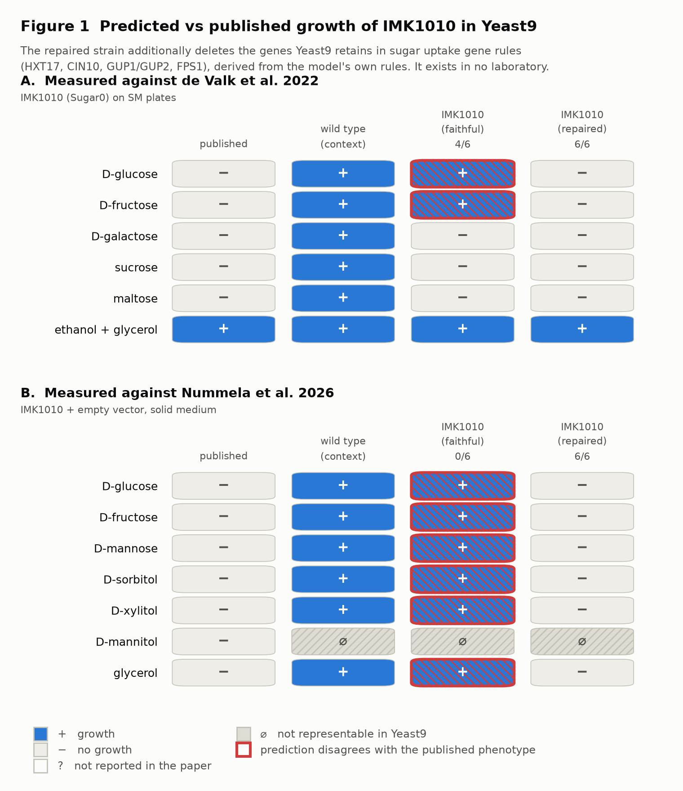
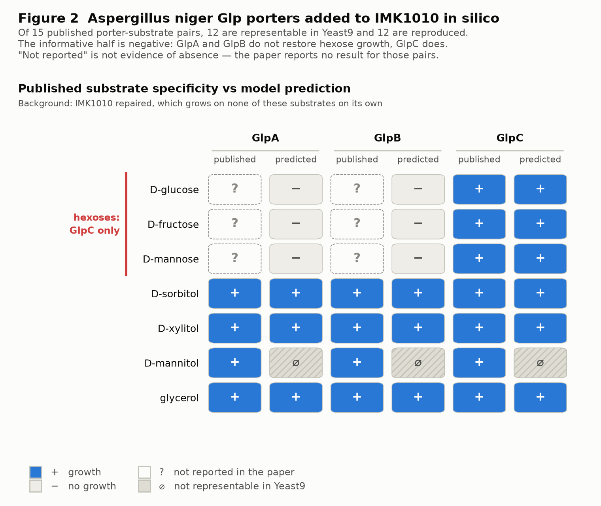

# IMK1010 in silico: constraint-based analysis with COBRApy and Yeast9

Can a community genome-scale metabolic model reproduce the phenotype of a yeast
strain built specifically to *abolish* sugar uptake? IMK1010 ("Sugar0") is a
*Saccharomyces cerevisiae* strain in which 23 transporter and 9 hydrolase genes
have been deleted, so that it grows on almost no sugar; it exists as a platform
for characterising heterologous transporters. This project reconstructs IMK1010
in **Yeast9** with COBRApy, compares flux-balance predictions with the published
growth phenotypes, and then asks whether adding three *Aspergillus niger*
glycerol/polyol transporters (GlpA, GlpB, GlpC) restores growth in the model in
the same pattern reported experimentally. The headline result is a negative one:
the genotype-faithful reconstruction fails, for a specific and traceable reason
in the model's gene–protein–reaction rules.

## Summary of findings

1. **Yeast9 cannot represent a transporter-deletion strain from its gene rules
   alone.** Sugar uptake reactions in Yeast9 carry long `OR` gene rules, and an
   `OR` rule survives as long as one gene survives. Several genes in those rules
   — **HXT17, CIN10, GUP1/GUP2 and FPS1** — were never deleted in IMK1010, so
   deleting all 32 published genes leaves uptake wide open.
2. Deleting those retained genes as well reproduces every published phenotype
   from both papers. The genes to delete are **derived from the model's own gene
   rules**, not chosen by hand.
3. Adding the Glp porters to that background reproduces the published substrate
   specificity, including the part that discriminates between porters: GlpA and
   GlpB do not restore growth on hexoses, GlpC does.
4. **Yeast9 cannot represent mannitol uptake at all**, although it carries the
   mannitol catabolic step. The gap is transport, not pathway.

## How to run

```bash
mamba env create -f environment.yml      # or: conda env create -f environment.yml
mamba activate imk1010_gem
pip install -e .

python scripts/download_model.py         # fetches Yeast9 and verifies its SHA-256
python scripts/run_part_a.py             # -> results/carbon_panel.csv, uptake_survivors.csv
python scripts/run_part_b.py             # -> results/glp_predictions.csv
python scripts/make_figures.py           # -> results/figures/
pytest                                   # 34 tests
```

The SBML file is about 12 MB and is therefore **not** committed. It is fetched by
`scripts/download_model.py`, which verifies the checksum and refuses to keep a
file that does not match, so a clean clone runs against exactly the model
documented below.

## Model version

| | |
|---|---|
| Model | Yeast9 (`yeast-GEM`), release `v9.1.1` ("yeast 9.1.1") |
| Repository | <https://github.com/SysBioChalmers/yeast-GEM> |
| Commit | `2d594ae1c4a2d550ccef120d96a58c7bbf586255` |
| File | `model/yeast-GEM.xml` (11,568,534 bytes) |
| SHA-256 | `30842b15eefb0ef7e36cbdea86a9efddfacf69a871c8b054165faa9af9f6c8eb` |
| Contents | 4,105 reactions, 2,748 metabolites, 1,143 genes |
| Objective | `r_2111` ("growth") |

Recorded in `data/model/MODEL_PROVENANCE.json`. Solver: GLPK via optlang.

A practical note on the model: Yeast9 stores each gene's systematic ORF name as
the SBML gene product ID and its common name in the `fbc:label` attribute, which
COBRApy does not expose — `gene.name` comes back empty. Since the published gene
lists are written in common names, `model_io.py` parses those labels out of the
SBML, so the `HXT1` → `YHR094C` mapping comes from the model file itself rather
than from an external assumption.

## Data sources

All data are from published work. No unpublished data are used.

| Source | Used for | Licence |
|---|---|---|
| **de Valk SC, Bouwmeester SE, de Hulster E, Mans R (2022).** *Biotechnology for Biofuels and Bioproducts.* PMCID [PMC9077909](https://www.ncbi.nlm.nih.gov/pmc/articles/PMC9077909/) | IMK1010 genotype, the 32 deleted genes, growth phenotypes (Fig. 2) | CC BY 4.0 (article); CC0 (data) |
| **Wijsman M et al. (2019).** *FEMS Yeast Research.* | Cross-check of the Hxt0 (IMX1812) hexose-transporter gene list | CC BY-NC-ND 4.0 — facts only; no tables or figures reproduced here |
| **Nummela et al. (2026).** | GlpA/GlpB/GlpC substrate specificity in IMK1010 (Fig. 4) | CC BY 4.0 |
| **Xu L et al. (2024).** *Bioresource Technology* 391:130006. | Context on characterised fungal sugar transporters | Open access, Creative Commons (specific variant not confirmed) |
| **Yeast9** — SysBioChalmers/yeast-GEM | The metabolic model | see repository |

The repository owner is a co-author of Nummela et al. (2026) and of Xu et al.
(2024).

Derived data files in `data/` record the `source_paper` and `source_location`
(figure or table) for every value, so each number can be traced to its origin.
`data/published_phenotypes.csv` additionally flags rows that were *inferred from
the assay design* rather than stated outright in the source.

## Part A — reconstructing IMK1010

29 of the 32 published genes map onto Yeast9. The three that do not — **HXT12,
MAL21 and MAL22** — are a genuine strain-background difference: Yeast9 is built
on S288C, whereas IMK1010 derives from CEN.PK and carries the CEN.PK-specific
`MAL2-8C` allele.

Two strains are compared:

- **IMK1010 (faithful)** — exactly the 32 published deletions.
- **IMK1010 (repaired)** — the same, plus the genes Yeast9 retains in the uptake
  rules for the substrates tested. These extra genes are computed by
  `strains.surviving_uptake_genes()` from the model's gene rules.
  **This strain does not exist in any laboratory.** It is a diagnostic that
  isolates the effect of the model's annotation, not a reconstruction of
  anything real.

### Why the faithful reconstruction fails

`results/uptake_survivors.csv`, abbreviated:

| Substrate | Uptake reaction | Genes still functional in IMK1010 |
|---|---|---|
| D-glucose | `r_1166` | **CIN10, HXT17** |
| D-fructose | `r_1134` | **HXT17** |
| D-mannose | `r_1139` | **HXT17** |
| D-sorbitol | `r_1717` | **HXT17** |
| D-xylitol | `r_2105` | **FPS1** |
| glycerol | `r_1171` | **GUP1, GUP2** |
| ethanol | `r_1762` | *(no gene rule — passive diffusion)* |
| sucrose, maltose, D-galactose | — | uptake genuinely blocked |

Yeast9's glucose transport rule `r_1166` is an `OR` over twenty genes, two of
which (HXT17, CIN10) were never deleted in IMK1010. Sucrose, maltose and
galactose come out correct precisely because their rules contain only genes that
*were* deleted — which is what makes this a specific annotation problem rather
than a broken reconstruction.

### Results



| Strain | vs de Valk 2022 | vs Nummela 2026 (empty vector) |
|---|---|---|
| IMK1010 (faithful) | 4/6 | **0/6** |
| IMK1010 (repaired) | 6/6 | 6/6 |

**These ratios should not be read as accuracy scores.** Most published values are
"no growth", so a trivial predictor that said "nothing grows" would score 5/6
against de Valk and 6/6 against Nummela. The faithful model scores 0/6 against
Nummela — worse than the trivial predictor. What matters is not the ratio but
that every failure has a single named cause, and that the cause is structural:
gene rules record which genes *can* catalyse a reaction, never which combinations
are sufficient to abolish it.

The two panels differ only in which substrates each paper tested. de Valk's panel
includes disaccharides and galactose, whose rules contain no retained genes, so
the faithful model gets those right. Nummela's panel is entirely hexoses and
polyols, which is where every retained gene sits.

**Positive control.** Nummela et al. used HXT5-expressing IMK1010 as a positive
control. Modelled by leaving HXT5 functional in the repaired background, it
restores growth on D-glucose, D-fructose and D-mannose and on nothing else —
which is what a hexose transporter should do, and a check that the repair did not
simply break the model.

## Part B — the *A. niger* Glp porters

Each porter is added to the repaired background as facilitated transport of its
published substrates, and growth is tested. The repaired background is the
deliberate choice: in the faithful strain Yeast9 already predicts growth on all
of these substrates, so no porter could show an effect.



Of the 15 published porter–substrate pairs, 12 are representable in Yeast9 and
all 12 are reproduced.

**The 12/12 is not the informative part.** Adding a transporter for a substrate
the model can already catabolise will of course produce growth. What is
informative is the negative half: **GlpA and GlpB do not restore growth on
D-glucose, D-fructose or D-mannose, while GlpC does**, matching the published
specificity. If the substrate assignments were wrong, that asymmetry would
collapse.

Note that "not reported" in Figure 2 is not evidence of absence: Nummela et al.
report no result for GlpA/GlpB on the hexoses, and the figure distinguishes that
from a reported negative.

### The mannitol gap

All three porters restored growth on mannitol experimentally, but **Yeast9 has no
extracellular mannitol pool and no mannitol exchange reaction**, so no strain can
take mannitol up under any circumstances. The catabolic step is present:
`r_4183`, mannitol + NAD⁺ ⇌ D-fructose + NADH (`DSF1 or MAN2`).

Adding only the uptake side — an extracellular metabolite, an exchange reaction
and a transport reaction — restores growth for all three porters (0.0867 h⁻¹).
**The gap in Yeast9 is therefore transport, not pathway.** This extension goes
beyond what Yeast9 ships; it is applied to a separate, labelled strain and
reported as an extension, never folded into the main results.

## A hypothesis raised and withdrawn

Early in the work, de Valk's ethanol/glycerol plate was read as two separate
conditions, which implied that IMK1010 grew on glycerol alone despite lacking
STL1. That would have required a passive uptake route, and Yeast9 constrains the
Fps1/Aqy3 glycerol channel (`r_1172`) to export only — so a model edit making the
channel bidirectional was proposed and did reconcile the model with the data.

That plate contained **both** 2% ethanol and 2% glycerol. Ethanol requires no
sugar transporter and accounts for the growth on its own, so there is no
published evidence of glycerol-only growth; Nummela's empty-vector control did
not grow on 1% glycerol. **No observation requires the edit, and it is
withdrawn.** The function remains in `strains.py`, documented as tested and
unused, because a channel modelled as one-way is still a real limitation of
Yeast9 worth naming, and because a withdrawn hypothesis belongs in the record.

## Limitations

- **FBA ignores kinetics, affinity, regulation and expression level.** GlpC
  required 8% glucose and 8% fructose to show growth but only 1% for the polyols,
  which suggests low hexose affinity. The model cannot represent that: in FBA a
  transporter either exists or it does not.
- **Growth on a plate is not a growth rate.** The published readouts are
  growth/no-growth after 2–8 days. The predicted rates in the results files are
  therefore not comparable to anything measured, and no such comparison is made.
- **Strain background.** Yeast9 is built on S288C; IMK1010 derives from CEN.PK.
  Three of the 32 deleted genes (HXT12, MAL21, MAL22) are absent from the model.
- **Transport stoichiometry for the Glp porters is an assumption.** Nummela et
  al. do not report the mechanism; the porters are modelled as facilitated
  diffusion without proton coupling. This does not affect growth/no-growth, but
  it would affect any yield or flux comparison.
- **The repaired strain is a diagnostic, not a strain.** Its extra deletions are
  derived from the model, but no such organism exists.
- **Part B is a demonstration, not a validation.** Three porters, one host, a
  qualitative readout.
- **Uptake bounds.** Yeast9's own default bound (1 mmol gDW⁻¹ h⁻¹) is applied to
  whichever carbon source is open, so no uptake rate is invented. Growth/no-growth
  conclusions do not depend on it; predicted rates do.

## Repository layout

```
├── data/
│   ├── model/MODEL_PROVENANCE.json    # pinned Yeast9 release, commit, checksum
│   ├── imk1010_deleted_genes.csv      # the 32 deleted genes, with sources
│   ├── published_phenotypes.csv       # growth phenotypes from both papers
│   └── nummela2026_glp.csv            # Glp substrate specificity
├── src/imk1010_gem/
│   ├── model_io.py                    # loading Yeast9; recovering gene names
│   ├── media.py                       # minimal medium with one carbon source
│   ├── strains.py                     # IMK1010 and the repaired diagnostic
│   ├── porters.py                     # adding the Glp porters
│   └── analysis.py                    # growth panels and comparison tables
├── scripts/                           # download_model, run_part_a, run_part_b, make_figures
├── results/                           # generated CSVs and figures
└── tests/                             # 34 tests
```

The tests assert the *disagreements* explicitly as well as the agreements, so
that a future change which quietly makes a known failure disappear will fail the
suite rather than pass silently.

## Licence

Code in this repository is released under the MIT Licence (see `LICENSE`). Data
files under `data/` are derived from the published sources listed above and
remain subject to those sources' terms; each file records its origin.
