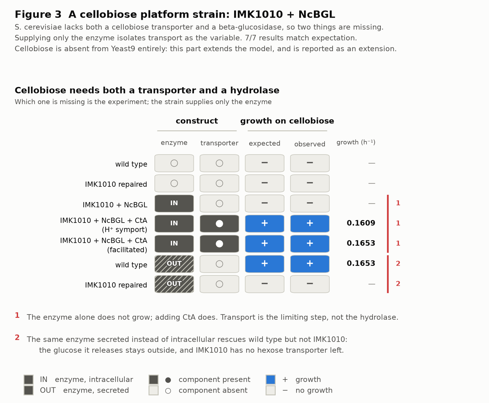

# IMK1010 in silico: constraint-based analysis with COBRApy and Yeast9

Can a community genome-scale metabolic model reproduce the phenotype of a yeast
strain built specifically to *abolish* sugar uptake? IMK1010 ("Sugar0") is a
*Saccharomyces cerevisiae* strain in which 23 transporter and 9 hydrolase genes
have been deleted, so that it grows on almost no sugar; it exists as a platform
for characterising heterologous transporters. This project reconstructs IMK1010
in **Yeast9** with COBRApy, compares flux-balance predictions with the published
growth phenotypes, then asks whether adding three *Aspergillus niger*
glycerol/polyol transporters (GlpA, GlpB, GlpC) restores growth in the model in
the same pattern reported experimentally, and finally builds a cellobiose
platform strain to ask a question the first two parts cannot: what happens when
a transporter is *not* enough on its own.

## Summary of findings

1. **Yeast9 cannot represent a transporter-deletion strain from its gene rules
   alone.** Sugar uptake reactions in Yeast9 carry long `OR` gene rules, and an
   `OR` rule survives as long as one gene survives. Several genes in those rules
   — **HXT17, CIN10, GUP1/GUP2 and FPS1** — were never deleted in IMK1010, so
   deleting all 32 published genes leaves uptake wide open.
2. Deleting those retained genes as well reproduces every published phenotype
   from both papers. The genes to delete are **derived from the model's own gene
   rules**, not chosen by hand.
3. Adding the Glp porters to that background reproduces the published substrate
   specificity across both published positives and published negatives: GlpA and
   GlpB do not restore growth on D-glucose, D-fructose or D-mannose, GlpC does,
   and no porter restores growth on D-galactose.
4. **Yeast9 cannot represent mannitol uptake at all**, although it carries the
   mannitol catabolic step. The gap is transport, not pathway.
5. For cellobiose, by contrast, **transport is not sufficient**: a hydrolase is
   needed as well. A platform strain carrying only the enzyme isolates which of
   the two is limiting, and the localisation of that enzyme decides whether the
   strain can grow at all.

## How to run

```bash
mamba env create -f environment.yml      # or: conda env create -f environment.yml
mamba activate imk1010_gem
pip install -e .

python scripts/download_model.py         # fetches Yeast9 and verifies its SHA-256
python scripts/run_part_a.py             # -> results/carbon_panel.csv, uptake_survivors.csv
python scripts/run_part_b.py             # -> results/glp_predictions.csv
python scripts/run_part_c.py             # -> results/cellobiose_panel.csv
python scripts/make_figures.py           # -> results/figures/
python scripts/verify_readme.py          # re-derives every number in this file
pytest                                   # 48 tests
```

The SBML file is fetched by `scripts/download_model.py`, which verifies the
checksum and refuses to keep a file that does not match, so a clean clone
runs against exactly the model documented below.

## Model version

| | |
|---|---|
| Model | Yeast9 (`yeast-GEM`), release `v9.1.1` ("yeast 9.1.1") |
| Repository | <https://github.com/SysBioChalmers/yeast-GEM> |
| Commit | `2d594ae1c4a2d550ccef120d96a58c7bbf586255` |
| File | `model/yeast-GEM.xml` (11,568,534 bytes) |
| SHA-256 | `30842b15eefb0ef7e36cbdea86a9efddfacf69a871c8b054165faa9af9f6c8eb` |
| Contents | 4,105 reactions, 2,748 metabolites, 1,143 genes |
| Objective | `r_2111` ("growth") |

Recorded in `data/model/MODEL_PROVENANCE.json`. Solver: GLPK via optlang.

## Data sources

All data are from published work. No unpublished data are used.

| Source | Used for | Licence |
|---|---|---|
| **de Valk SC, Bouwmeester SE, de Hulster E, Mans R (2022).** *Biotechnology for Biofuels and Bioproducts.* [doi:10.1186/s13068-022-02145-7](https://doi.org/10.1186/s13068-022-02145-7) | IMK1010 genotype, the 32 deleted genes, growth phenotypes (Fig. 2) | CC BY 4.0 |
| **Wijsman M et al. (2019).** *FEMS Yeast Research.* [doi:10.1093/femsyr/foy107](https://doi.org/10.1093/femsyr/foy107) | Cross-check of the Hxt0 (IMX1812) hexose-transporter gene list | CC BY-NC-ND 4.0 |
| **Nummela et al. (2026).** *Applied Microbiology and Biotechnology* [doi:10.1007/s00253-026-13854-6](https://doi.org/10.1007/s00253-026-13854-6) | GlpA/GlpB/GlpC substrate specificity in IMK1010 (Fig. 4) | CC BY 4.0 |
| **Xu L et al. (2024).** *Bioresource Technology.* [doi:10.1016/j.biortech.2023.130006](https://doi.org/10.1016/j.biortech.2023.130006) | Context on characterised fungal sugar transporters | CC BY 4.0 |
| **Galagan J, Calvo S, Borkovich K et al. (2003).** *Nature.* [doi:10.1038/nature01554](https://doi.org/10.1038/nature01554) | *N. crassa* genome; prediction of NCU00130 | CC BY-NC-SA 3.0 |
| **Galazka JM et al. (2010).** *Science* 330:84–86. [doi:10.1126/science.1192838](https://doi.org/10.1126/science.1192838) | Characterisation of the intracellular β-glucosidase GH1-1 used as `NcBGL` | AAAS default licence — not open access; public access via CHORUS after a 12-month embargo |
| **Lin H, Zhao J, Zhang Q, Cui S, Fan Z, Chen H, Tian C (2020).** *Frontiers in Microbiology* 11:145. [doi:10.3389/fmicb.2020.00145](https://doi.org/10.3389/fmicb.2020.00145) | Characterisation of the *A. niger* cellodextrin transporter CtA | CC BY 4.0 |
| **Liu JJ, Zhang GC, Oh EJ, Pathanibul P, Turner TL, Jin YS (2016).** *Journal of Biotechnology* 234:99–104. [doi:10.1016/j.jbiotec.2016.07.018](https://doi.org/10.1016/j.jbiotec.2016.07.018), PMID 27457698 | Confirms GH1-1 lactose activity (recorded in `data/`, not modelled here) | — |
| **Yeast9** — SysBioChalmers/yeast-GEM | The metabolic model | see repository |

**On the restrictive licences.** Three sources are not openly licensed: Wijsman
et al. (CC BY-NC-ND 4.0), Galagan et al. (CC BY-NC-SA 3.0) and Galazka et al.
(AAAS, subscription). Nothing in this repository reproduces their text, tables
or figures. The code here remains under the MIT licence, and the data files
carry their own sources' terms, recorded per row.

Derived data files in `data/` record the `source_paper` and `source_location`
(figure or table) for every value.

## Part A — reconstructing IMK1010

29 of the 32 published genes map onto Yeast9. **HXT12,
MAL21 and MAL22** are a strain-background difference: Yeast9 is built
on S288C, whereas IMK1010 derives from CEN.PK and carries the CEN.PK-specific
`MAL2-8C` allele.

Two strains are compared:

- **IMK1010 (faithful)** — exactly the 32 published deletions.
- **IMK1010 (repaired)** — the same, plus the genes Yeast9 retains in the uptake
  rules for the substrates tested. These extra genes are computed by
  `strains.surviving_uptake_genes()` from the model's gene rules.
  **This strain does not exist in any laboratory.** It is a diagnostic that
  isolates the effect of the model's annotation, not a reconstruction of
  anything real.

### Why the faithful reconstruction fails

`results/uptake_survivors.csv`, abbreviated:

| Substrate | Uptake reaction | Genes still functional in IMK1010 |
|---|---|---|
| D-glucose | `r_1166` | **CIN10, HXT17** |
| D-fructose | `r_1134` | **HXT17** |
| D-mannose | `r_1139` | **HXT17** |
| D-sorbitol | `r_1717` | **HXT17** |
| D-xylitol | `r_2105` | **FPS1** |
| glycerol | `r_1171` | **GUP1, GUP2** |
| ethanol | `r_1762` | *(no gene rule — passive diffusion)* |
| sucrose, maltose, D-galactose | — | uptake genuinely blocked |

Yeast9's glucose transport rule `r_1166` is an `OR` over twenty genes, two of
which (HXT17, CIN10) were never deleted in IMK1010. Sucrose, maltose and
galactose come out correct precisely because their rules contain only genes that
*were* deleted — which is what makes this a specific annotation problem rather
than a broken reconstruction.

### Results


| Strain | vs de Valk 2022 | vs Nummela 2026 (empty vector) |
|---|---|---|
| trivial predictor: "nothing grows" | 5/6 | 7/8 |
| IMK1010 (faithful) | 4/6 | **2/8** |
| IMK1010 (repaired) | **6/6** | **8/8** |

Against that baseline the faithful model does **worse than predicting nothing**:
4/6 and 2/8. The repaired model beats it on both, 6/6 and 8/8. What matters more
than either ratio is that every failure has a single named cause, and that the
cause is structural: gene rules record which genes *can* catalyse a reaction,
never which combinations are sufficient to abolish it.

The faithful model's 2/8 against Nummela is not quite zero because it gets
**ethanol** and **D-galactose** right: ethanol needs no sugar transporter at
all, and the galactose rule contains no retained gene. Everything that depends on
a retained transporter fails.

The two panels differ only in which substrates each paper tested. de Valk's panel
includes disaccharides and galactose, whose rules contain no retained genes, so
the faithful model gets those right. Nummela's panel is mostly hexoses and
polyols, which is where every retained gene sits.

**Positive control.** Nummela et al. used HXT5-expressing IMK1010 as a positive
control. Modelled by leaving HXT5 functional in the repaired background, it
restores growth on D-glucose, D-fructose and D-mannose and on nothing else —
which is what a hexose transporter should do, and a check that the repair did not
simply break the model.

## Part B — the *A. niger* Glp porters

Each porter is added to the repaired background as facilitated transport of its
published substrates, and growth is tested. The repaired background is the
deliberate choice: in the faithful strain Yeast9 already predicts growth on all
of these substrates, so no porter could show an effect.


Of the 27 published porter–substrate pairs, 24 are representable in Yeast9, and
the model reproduces **24/24** of them: **15/15 where the paper reports growth,
and 9/9 where it reports none.** The 3 excluded pairs are D-mannitol, which
Yeast9 cannot represent at all.

### The mannitol gap

All three porters restored growth on mannitol experimentally, but **Yeast9 has no
extracellular mannitol pool and no mannitol exchange reaction**, so no strain can
take mannitol up under any circumstances. The catabolic step is present:
`r_4183`, mannitol + NAD⁺ ⇌ D-fructose + NADH (`DSF1 or MAN2`).

## Part C — a cellobiose platform strain

*S. cerevisiae* has neither a cellobiose transporter nor a β-glucosidase, so
**two** things are missing, and which one limits growth is the experiment. The
platform strain supplies only the enzyme: IMK1010 (repaired) carrying an
intracellular β-glucosidase, `NcBGL`, modelled after *N. crassa* GH1-1
(locus NCU00130, accession XP_011393758.1).

**Cellobiose is absent from Yeast9 entirely.** Part C therefore *extends* the model with an
extracellular and a cytosolic pool, an exchange reaction, a transporter and a
hydrolase. Like the mannitol extension in Part B, this is reported as an
extension and never as a result the published model produced.



| Strain | Construct | Growth (h⁻¹) |
|---|---|---|
| wild type | cellobiose available, no enzyme | 0.0000 |
| IMK1010 (repaired) | cellobiose available, no enzyme | 0.0000 |
| **IMK1010 + NcBGL** | intracellular BGL, **no transporter** | **0.0000** |
| **IMK1010 + NcBGL + CtA** | intracellular BGL + CtA (H⁺ symport) | **0.1609** |
| **IMK1010 + NcBGL + CtA** | intracellular BGL + CtA (facilitated) | **0.1653** |
| wild type | secreted BGL, no transporter | 0.1653 |
| IMK1010 (repaired) | secreted BGL, no transporter | 0.0000 |

7/7 results match expectation. The transporter is **CtA** from *A. niger*
(locus An12g09270, accession MH648002), characterised by Lin et al. (2020).

### Localisation is the design, not a detail

The last two rows are a control on the enzyme's location rather than on its
activity. A **secreted** β-glucosidase hydrolyses cellobiose outside the cell
and releases glucose into the medium: wild type grows on that (0.1653), and
IMK1010 cannot (0.0000), because it has no hexose transporter left to take the
glucose back up.

### Two things asserted by tests rather than by prose

- **The hydrolysis is mass-balanced**: C₁₂H₂₂O₁₁ + H₂O → 2 C₆H₁₂O₆, checked
  with `reaction.check_mass_balance()`. If it did not balance, every number
  downstream would be meaningless.
- **The reaction contains no NAD(P)H or FAD.** A β-glucosidase is a hydrolase,
  not a dehydrogenase, so there is no redox step and no cofactor imbalance to
  resolve, unlike a cellobiose dehydrogenase, or the xylose
  reductase/xylitol dehydrogenase pair.

### What the transport mechanism costs

CtA's mechanism is not confirmed in the source, so both proton symport and
facilitated diffusion are run and reported. Growth/no-growth is unaffected;
symport costs **2.7%** of growth rate (0.1609 against 0.1653).

`data/cellobiose_constructs.csv` additionally records that GH1-1 hydrolyses
lactose (Liu et al. 2016). **That is not modelled in this repository**; it is
recorded as a documented possible extension only.

## Limitations

- **FBA ignores kinetics, affinity, regulation and expression level.** GlpC
  required 8% glucose and 8% fructose to show growth but only 1% for the polyols,
  which suggests low hexose affinity. The model cannot represent that.
- **Growth on a plate is not a growth rate.** The published readouts are
  growth/no-growth after 2–8 days. The predicted rates in the results files are
  therefore not comparable to anything measured, and no such comparison is made.
- **FBA has no notion of culture method, and the two published methods
  disagree.** Nummela et al. also report liquid cultures, in which the porters
  did *not* restore growth on glycerol or the polyols. This project models and
  compares against the **solid** readout only, because that is what the substrate
  specificity claims rest on. A flux-balance model has no colony, no gradient, no
  suspension and no local concentration, so it cannot represent the difference
  between the two; it can only be compared against one of them. The mismatch is
  reported here rather than resolved.

  Oxygen limitation in liquid culture would be a tempting explanation, since
  glycerol and the polyols are non-fermentable and require respiration — but
  every strain also grew on ethanol, which is likewise non-fermentable, so that
  explanation does not hold. We cannot account for the difference.
- **Changing the growth condition is substantial work, not a flag.** While
  comparing proton symport against facilitated transport in Part C, we attempted
  the same comparison anaerobically, where the ATP cost of symport should matter
  far more. Yeast9 would not grow anaerobically at all, even with sterols and
  unsaturated fatty acids supplemented, so no anaerobic number is reported. That
  and the solid/liquid mismatch are the same lesson: the model is configured for
  one assumed condition.
- **Strain background.** Yeast9 is built on S288C; IMK1010 derives from CEN.PK.
  Three of the 32 deleted genes (HXT12, MAL21, MAL22) are absent from the model.
- **Transport stoichiometry for the Glp porters is an assumption.** Nummela et
  al. do not report the mechanism; the porters are modelled as facilitated
  diffusion without proton coupling. This does not affect growth/no-growth, but
  it would affect any yield or flux comparison.
- **The repaired strain is a diagnostic, not a strain.** Its extra deletions are
  derived from the model, but no such organism exists.
- **Part B is a demonstration, not a validation.** Three porters, one host, a
  qualitative readout.
- **FBA cannot rank transporters of the same substrate.** Without affinities,
  two transporters with identical stoichiometry give identical predictions, so
  no conclusion in this repository distinguishes one cellobiose transporter from
  another. Published Km values exist for some of them and are not used, because
  nothing in flux-balance analysis consumes them.
- **CtA's transport mechanism is assumed.** The source does not state whether
  uptake is proton-coupled; both variants are reported, and they differ in
  predicted rate but not in growth/no-growth.
- **The cellobiose pools are our addition.** Cellobiose does not exist in
  Yeast9, so Part C extends the model rather than querying it. Results from an
  extended model are evidence about the extension, not about Yeast9 as
  published — the same caveat as the mannitol extension in Part B.
- **Part C's comparison is with design expectation, not with a measurement.**
  The 7/7 records that each strain behaved as the construct logic predicts; no
  cellobiose growth experiment from this strain is being reproduced.
- **Uptake bounds.** Yeast9's own default bound (1 mmol gDW⁻¹ h⁻¹) is applied to
  whichever carbon source is open, so no uptake rate is invented. Growth/no-growth
  conclusions do not depend on it; predicted rates do.

## Repository layout

```
├── data/
│   ├── model/MODEL_PROVENANCE.json    # pinned Yeast9 release, commit, checksum
│   ├── imk1010_deleted_genes.csv      # the 32 deleted genes, with sources
│   ├── published_phenotypes.csv       # growth phenotypes from both papers
│   ├── nummela2026_glp.csv            # Glp substrate specificity
│   └── cellobiose_constructs.csv      # NcBGL and CtA, with accessions and citations
├── src/imk1010_gem/
│   ├── model_io.py                    # loading Yeast9; recovering gene names
│   ├── media.py                       # minimal medium with one carbon source
│   ├── strains.py                     # IMK1010 and the repaired diagnostic
│   ├── porters.py                     # adding the Glp porters
│   ├── cellobiose.py                  # the cellobiose platform strain
│   └── analysis.py                    # growth panels and comparison tables
├── scripts/                           # download_model, run_part_a/b/c,
│                                      # make_figures, verify_readme
├── results/                           # generated CSVs and figures
└── tests/                             # 48 tests
```

The tests assert the *disagreements* explicitly as well as the agreements, so
that a future change which quietly makes a known failure disappear will fail the
suite rather than pass silently.

`scripts/verify_readme.py` re-derives every number in this README from the
committed result files and exits non-zero if any has drifted, so the prose cannot
fall out of step with the analysis unnoticed.

## Licence

Code in this repository is released under the MIT Licence (see `LICENSE`). Data
files under `data/` are derived from the published sources listed above and
remain subject to those sources' terms; each file records its origin.
